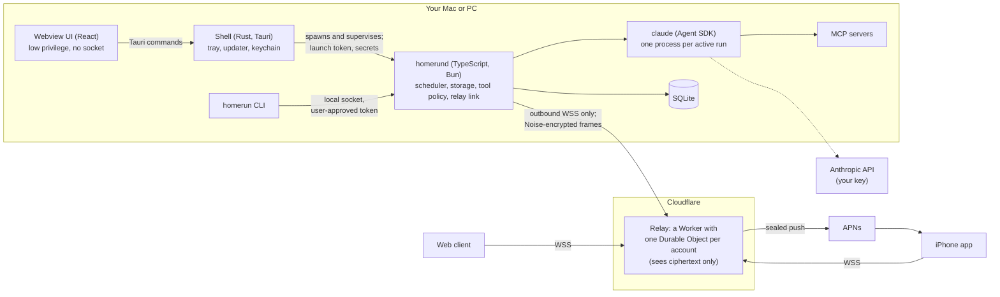

# Homerun

**A personal agent that runs on your own computer, and that you can control from your phone.**

Homerun is a desktop app for macOS and Windows that runs Claude agents, built on the
[Claude Agent SDK](https://www.npmjs.com/package/@anthropic-ai/claude-agent-sdk), on your machine, with
your files, your tools and your logins. An iPhone app and a web client let you follow, steer and
approve that work from anywhere. They connect through a small relay that only ever sees
end-to-end encrypted frames. You bring your own Anthropic API key. Your tasks, history and
credentials stay on your machine.

<!-- TODO: add a screenshot of the desktop app (a chat with a pending approval) next to the
     iPhone app answering it. Use a real capture; don't use a mock-up. -->

It runs two kinds of task:

| | Session | Monitor |
|---|---|---|
| Example | "Research X, write the report, iterate" | "Watch this page and tell me when Y changes" |
| Started by | You | A schedule |
| What must not happen | A crash loses hours of work | It silently stops running |

Most of the design follows from serving both kinds with one system
([design §2](docs/design.md#2-product-model-two-kinds-of-task)).

## Contents

- [Architecture](#architecture)
- [Design decisions](#design-decisions)
- [Security model](#security-model)
- [Testing](#testing)
- [Status](#status)
- [Quick start](#quick-start)
- [Repository layout](#repository-layout)
- [Documentation](#documentation)

## Architecture



- **One install.** The desktop app is a thin Rust shell that spawns and supervises
  `homerund`, the runtime. The runtime owns everything that matters: scheduling, storage, tool
  policy, the agent runs and the relay connection. Each active run is a `claude` process that the
  Agent SDK drives. Closing the window or updating the UI never stops a run
  ([§4](docs/design.md#4-system-shape), [§5.1](docs/design.md#51-process-model-one-app-runtime-in-a-child-process)).
- **One local protocol.** The desktop UI, the CLI and the test harnesses all speak the same
  authenticated JSON-RPC protocol to the runtime. Each kind of caller has its own allowlist of
  methods ([§5.2](docs/design.md#52-transport)).
- **One hosted service.** The relay forwards opaque frames between paired devices and sends push
  notifications. It runs no models and holds no agent state. Beyond accounts and device keys, it
  keeps only a bounded queue of encrypted messages waiting for an offline device
  ([§9.4](docs/design.md#94-relay-design),
  [§10.7](docs/design.md#107-what-the-server-stores)).

## Design decisions

The full reasoning is in [`docs/design.md`](docs/design.md), and each major choice has a row
in its [decision log](docs/design.md#18-decision-log) (155 rows so far). Here are the decisions
that shape the system most, with what each one costs.

### Local-first: the agent runs on your machine

A local agent can work with your files, repositories and development tools. It also reuses your
keychain, your existing CLI logins (`gh`, `az`, `kubectl`) and your browser sessions, so Homerun
never holds your tokens. Runs cost nothing to host, and we never run user-directed code on our
servers.

**Cost:** monitors only run while the machine is awake. This is the largest compromise in the
design, so it gets three mitigations. The runtime holds a power assertion while a run is in
flight. Fires missed during sleep are caught up on wake, using a policy set per schedule. And
every missed or abandoned fire produces a visible state and a notification. *"Never fail
silently"* is treated as P0, because a monitor that quietly stops is worse than none
([§3.1](docs/design.md#31-local-first-execution), [§8.1](docs/design.md#81-sleep--the-central-problem),
[§8.2](docs/design.md#82-never-fail-silently)).

### The desktop never listens on a public port

`homerund` can run shell commands. If it accepted inbound connections, one authentication bug
would mean remote code execution. Instead, the desktop dials out to the relay and keeps that
connection open, so there is no inbound surface and NAT is not a problem. The phone goes through
the relay even on the same Wi-Fi.

**Cost:** some extra latency, and remote access depends on the relay being up. The transport sits
behind an interface, so a direct path on trusted networks can be added later
([§9.2](docs/design.md#92-the-desktop-must-never-listen-on-a-public-port),
[§9.5](docs/design.md#95-no-direct-same-network-connection-in-v1)).

### A blind relay, and only because it is unavoidable

The relay exists for two reasons. Phones need APNs to receive approval requests, and APNs needs a
server that holds a signing key. Desktops are also behind NAT. Live sessions use
`Noise_KK_25519_ChaChaPoly_SHA256`, which gives mutual authentication and forward secrecy.
Messages for an offline recipient are *sealed* to its pinned key with Noise `K`. Each sealed
message carries a random id, an expiry and the sender inside the ciphertext, so replays are
rejected and an answer is applied at most once. The relay can see who talks to whom and when.
It can't read or forge frames. It *can* drop them.

**Cost:** sealed messages have no forward secrecy. This is why they expire quickly: after 12 hours
for a queued instruction, 24 hours for a push, and 1 hour for a lock-screen answer
([§3.2](docs/design.md#32-one-minimal-backend-blind-relay-push-and-identity),
[§9.4](docs/design.md#94-relay-design)).

### Device pinning, not device election

A task runs on the device where it was created, always. There are no leases, no leader
election and no cross-device sync. On one machine, a single-instance lock prevents double
execution.

**Cost:** two computers are two independent installs, and a lost desktop takes its history with
it. Encrypted backup is deferred
([§3.3](docs/design.md#33-device-pinning-not-device-election),
[§10.8](docs/design.md#108-recovery)).

### Build on the Claude Agent SDK, behind a narrow interface

The SDK provides a tested agent loop: tools, context compaction, permission hooks, `defer`,
resumable sessions and MCP. Homerun gives up model choice in exchange. The runtime talks to the
agent through five operations (`start`, `send`, `interrupt`, `answer` and an event stream), so
another engine can be added later without touching the scheduler, storage, protocol or clients.

**Cost:** coupling to a vendor. The SDK version is pinned exactly. An upgrade merges only after a
live eval suite passes. The suite also checks the undocumented SDK behaviour that Homerun depends
on ([§3.4](docs/design.md#34-claude-only-in-v1-on-the-claude-agent-sdk),
[§16.2](docs/design.md#162-testing-strategy)).

### Crash resume that never repeats a side effect blindly

The SDK transcript is saved to SQLite after every step, and resume reloads it. The hard case is
a crash in the middle of a tool call. Each call is recorded before it runs, and its result after
it finishes. A call with no result is *ambiguous*. Tools that only read, or are idempotent, are
retried. For any other tool, the run pauses and asks you *"Did this happen?"*. Your answer is
written into the transcript as the tool's result, and the run resumes with an explicit
continuation message. Resuming the transcript as it stands would usually make the model run the
call again.

This is tested by killing the runtime, and separately the `claude` process, after every event
*k* in a scenario. The tests then assert that there are no duplicate side effects, no lost
messages and no gaps in the event sequence
([§5.4](docs/design.md#54-crash-resume), [§16.2](docs/design.md#162-testing-strategy)).

### Approvals that can wait overnight without holding a process

A tool call outside the task's policy pauses for approval. If nobody answers within two minutes,
the hook returns the SDK's `defer` decision. The `claude` process then exits, and the run waits
without holding a process, a power assertion or a concurrency slot. When an answer arrives from
any device, the run resumes from storage. The first answer wins, because resolving a request is a
conditional update. A late answer from another device gets *"Already answered"*.

The model can request several tool calls at once, and the SDK can't turn that off. So a run has
at most one open request, and any other gated call is denied with *"re-issue after the pending
approval"*. *Always allow* creates a narrow grant: one task, one tool and an exact pattern. It
is never offered for destructive actions
([§5.6](docs/design.md#56-input-requests-approvals-and-questions)).

### Shared contracts, checked across languages

Homerun spans TypeScript, Rust and Swift. The runtime and the TypeScript clients share
one set of Zod schemas in [`packages/core`](packages/core/README.md): the task spec, the events,
and the IPC protocol with its per-caller allowlists. From these, the build generates JSON Schema
and test vectors for the Rust shell and the Swift code, and CI fails if the generated files are
out of date. The relay protocol has its own plain-JSON vectors in
[`packages/protocol`](packages/protocol/README.md), including negative cases: tampering, the
wrong key, expiry, replay and a lying sender. They are checked against an independent Noise
implementation, cacophony. The runtime, the relay (inside workerd as well), the reference
client, the Swift `HomerunKit` and the iPhone app's JavaScript under Hermes all pass the same
files ([§16.2](docs/design.md#162-testing-strategy)).

### Prove the risky parts first

Before any product code, milestone 0 was a spike of ten yes/no tests on real, signed builds, including:

- isolation from the developer's own `~/.claude`;
- a session round trip through SQLite;
- `defer` and a resume 189 minutes later;
- killing a run in the middle of a tool call;
- notarized hybrid signing, where `claude` keeps Anthropic's signature and we never re-sign a
  vendor binary;
- the keychain access group;
- an auto-update in the middle of a run.

Where a test exposed a problem, the fix went into the design. The items still open are listed,
not hidden ([§16.1](docs/design.md#161-milestone-0-prove-the-risky-parts-first),
[spike results](docs/spike-results.md)).

### Ship safely: signed builds, signed updates and a kill switch

Software that acts unattended on people's machines needs a way to stop a bad version. A
`v*` tag builds a macOS DMG and a Windows installer, signs each one when its secrets are set,
verifies the builds and publishes a release with `SHA256SUMS`. Updates are verified with Ed25519
before they run.

A minimum-version policy is signed offline. The runtime, the CLI, the iPhone app and the web
client check it. The policy can only restrict: it skips scheduled runs (it doesn't queue them)
and shows a banner. It never runs code or deletes data. It fails open when the client is offline,
so users can keep working. A compromised relay can withhold a policy, but it can't forge one.

Crash reports are opt-in, and each one is rebuilt from an allowlist of fields. The diagnostic
bundle is a zip saved locally that you can inspect, with ids hashed
([§11](docs/design.md#11-distribution), [§14](docs/design.md#14-desktop-app-and-updates)).

## Security model

Running the agent locally puts it inside your trust boundary, which raises the stakes. The main
threat is **prompt injection**: a web page, email or file that tries to steer the agent's tools.
Homerun's defence has several layers, and the design says plainly that it is *not a sandbox*
([§13](docs/design.md#13-security-model), [tool policy](docs/design.md#tool-policy)):

- **A hard denylist that nothing overrides.** It covers `~/.ssh`, keychains, browser profiles,
  `.env` files, cloud and package-manager credentials, and Homerun's own data. It is checked
  first, in the `PreToolUse` hook and again as SDK deny rules. No answer, grant or development
  flag can override it.
- **Tool classes and approval gates.** `Bash` counts as destructive unless the command matches
  an allowlisted pattern exactly, and a command with shell metacharacters never matches.
  Monitors have no `Bash` at all. Third-party MCP tools need approval until you trust them, and
  their own annotations can only tighten their class.
- **A taint rule with an egress allowlist.** Once a run reads untrusted content, any request to
  a domain outside the task's allowlist needs your approval. This cuts the exfiltration step even
  when an injection succeeds.
- **No inherited configuration.** Runs never load your `~/.claude` settings, hooks, skills or
  MCP servers.
- **Model output is displayed as data.** The UI never renders HTML from model output, never
  fetches remote images, and opens links outside the webview.
- **Every local connection authenticates.** Any program running as you can reach the socket. So
  the shell presents a fresh 256-bit token passed over stdin. The CLI's token must be approved
  in a native prompt that defaults to *Don't Allow*. Before sending anything, the CLI checks that
  the socket belongs to the signed runtime.
- **Remote devices have bounded authority.** A phone can approve a call the agent already
  proposed, but it can't inject a command. Destructive approvals on iPhone need a Face ID
  signature that the desktop verifies. The web client can approve read-only calls only.

The relay stores accounts, device public keys, device links, push tokens and a bounded queue of
undelivered sealed messages. Apart from that encrypted queue, it holds no task, run, prompt or
tool data ([§10.7](docs/design.md#107-what-the-server-stores)).

## Testing

The properties that matter most can't be checked by hand, so the test harnesses were built
alongside the milestones that needed them ([§16.2](docs/design.md#162-testing-strategy)):

- **No test needs an API key.** Replay tests run the real `claude` against API exchanges that
  were recorded once.
- **Crash at every boundary.** The tests kill the runtime and `claude` after every event, and
  check the invariants each time. Each pull request runs a seeded sample that includes every kind
  of boundary, and a nightly job runs them all.
- **A fake clock** covers DST gaps and overlaps, timezone changes, a week of sleep and every
  catch-up policy.
- **End-to-end tests** run Playwright against the desktop UI and the web client, with a real
  runtime behind them. Remote-access tests run the real runtime through the relay, with a local
  OIDC issuer and a mock APNs as stand-ins.
- **Cross-platform.** The runtime, the CLI and the shell's supervisor are tested on
  `windows-latest`. One test checks that a second local user is refused the named pipe. On iOS,
  `HomerunKit` runs the protocol vectors in `swift test`, and a release simulator build runs them
  under Hermes.

CI ([`ci.yml`](.github/workflows/ci.yml)) runs these as parallel jobs on every pull request.
It also checks that packages resolve only from the npm registry, that no secrets are committed,
and that every Markdown link and anchor resolves. [`nightly.yml`](.github/workflows/nightly.yml)
runs the full crash sweep, the remote-access suite against the real Worker in workerd, and the
Windows end-to-end suites, and builds the Tauri app on macOS and Windows. [`ios.yml`](.github/workflows/ios.yml) builds the iPhone app.
[`release.yml`](.github/workflows/release.yml) builds and publishes releases.

<details>
<summary>Running the tests locally</summary>

```sh
pnpm -r typecheck
pnpm check:doc-links
scripts/check-no-secrets.sh

# Contracts and protocol
pnpm --filter @homerun/core test
pnpm --filter @homerun/core schema:check      # generated JSON Schema and vectors are current
pnpm --filter @homerun/client test
pnpm --filter @homerun/protocol test
pnpm --filter @homerun/protocol vectors:check

# Runtime
pnpm --filter @homerun/homerund test:unit     # fake engine, no network
pnpm --filter @homerun/homerund test:replay   # real claude against recorded API exchanges
pnpm --filter @homerun/homerund test:crash    # kill at every event boundary (sampled)
pnpm --filter @homerun/homerund test:remote   # runtime, relay and reference client

# Relay and remote clients
pnpm --filter @homerun/relay test             # under Bun
pnpm --filter @homerun/relay test:workerd     # under workerd
pnpm --filter @homerun/remote test
pnpm --filter @homerun/web test
pnpm --filter @homerun/web test:e2e
pnpm --filter @homerun/ios test
pnpm --filter @homerun/ios test:swift         # macOS with Xcode

# CLI and desktop
pnpm --filter @homerun/cli test:unit
pnpm --filter @homerun/cli test:e2e
pnpm --filter @homerun/cli test:replay
pnpm --filter @homerun/app-state test
pnpm --filter @homerun/desktop test           # component tests
pnpm --filter @homerun/desktop test:e2e       # the UI against a real homerund
(cd apps/desktop/src-tauri && cargo test -p homerun-shell-core)
```

Each package README describes its own suites.

</details>

## Status

Milestone 0, the spike, is done, with its open items listed. Milestones 1 through 11 of the
[build plan](docs/design.md#16-build-plan) are built and tested in CI against local stand-ins:

- the runtime, with crash resume, the scheduler and monitors, and approvals and questions;
- the CLI;
- the macOS and Windows desktop app;
- accounts, the relay and push;
- the iPhone app and the web client;
- the release pipeline, the version gate, crash reports and the diagnostic bundle.

There is no public release yet. The remaining steps need a person and real accounts, and each
one is documented:

- creating the WorkOS, Cloudflare and Apple accounts and deploying the relay;
- the first signed and notarized release;
- testing on a real iPhone through TestFlight;
- creating the offline policy key, without which the version gate stays off, and the Sentry
  project, without which the crash-report setting stays hidden.

See the [relay's deploy steps](apps/relay/README.md#deploying), the
[first signed release](apps/desktop/README.md#first-signed-release), and the manual checks for
the [desktop](apps/desktop/README.md#manual-checks) and [iPhone](apps/ios/README.md#manual-checks)
apps. Open questions are tracked in [§17](docs/design.md#17-open-questions), and features
deliberately left out of v1 are listed in [§15](docs/design.md#15-deferred).

## Quick start

You need macOS or Linux, [Bun](https://bun.sh) 1.4.2, pnpm 11.5.0 and Node 22 or later.

```sh
pnpm install
pnpm --filter @homerun/desktop tauri dev    # the desktop app (macOS, Rust 1.94)
```

Or run the runtime without the app, with a dev shell standing in for it. The dev shell reads
your key from `ANTHROPIC_API_KEY`, or asks for it.

```sh
pnpm --filter @homerun/homerund dev
```

Then, in another terminal, from the repository root:

```sh
pnpm homerun status
pnpm homerun chat
```

For more, see the [desktop app README](apps/desktop/README.md), the
[CLI README](apps/cli/README.md) for every command, and the
[runtime README](apps/homerund/README.md) for the dev shell's options.

## Repository layout

```
apps/
  homerund/   the runtime: agent runs, SQLite storage, crash resume, scheduler, tool policy
  desktop/    the macOS and Windows app: Tauri shell (Rust) and React UI
  cli/        `homerun`, the command-line client
  ios/        the iPhone app: React Native views, native Swift for keys, push and Face ID
  web/        the web client: the desktop's views over the relay, as static files
  relay/      the relay: a Cloudflare Worker and Durable Objects, plus a Bun adapter for tests
packages/
  core/       shared contracts: Zod schemas, generated JSON Schema, test vectors
  protocol/   the relay protocol: Noise sessions, sealed messages, pairing, test vectors
  client/     how a local process finds and authenticates to homerund
  app-state/  the platform-neutral state layer under the desktop, web and iPhone views
  remote/     the remote client: device keys, sign-in, pairing, transport over the relay
  testkit/    test doubles: a local OIDC issuer and a mock APNs
  win32/      Windows bindings over bun:ffi
spikes/       milestone 0 experiments
scripts/      repository checks, and the macOS, Windows and release scripts
docs/         the design document and the milestone 0 results
```

Every app and package has its own README covering its interfaces, rules and tests.

## Documentation

- [`docs/design.md`](docs/design.md) is the authoritative spec. It covers what Homerun does and
  why, the security model, the build plan and the
  [decision log](docs/design.md#18-decision-log).
- [`docs/spike-results.md`](docs/spike-results.md) is the milestone 0 test record, with
  measurements.
